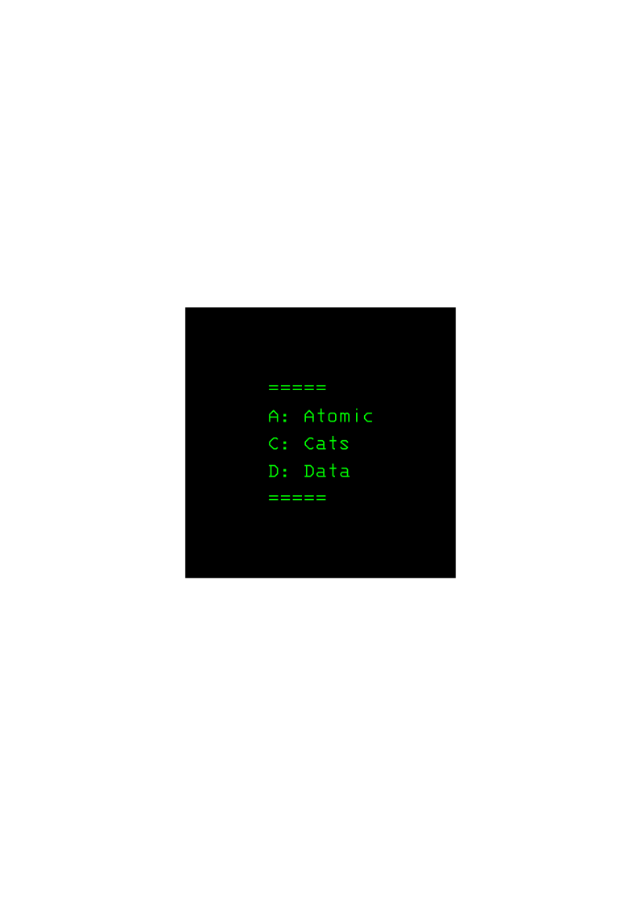

# ACD (Atomic Cats Data)

- Формат для хранения данных.

## Правила

- Разделитель - =====.
- Пустые строки - ошибка.
- Формат времени - 9:00 AM.
- Пример:
Математика
Кабинет: ...
Время начала: ...
Время конца: ...
=====
Английский язык
Кабинет: ...
Время начала: ...
Время конца: ...

- ... - незаполненные данные.
